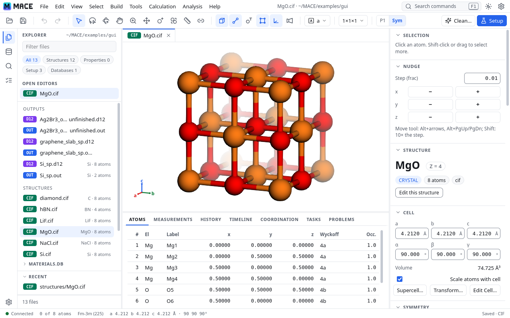

# MACE - Mendoza Automated CRYSTAL Engine

<p align="center">
  <picture>
    <source media="(prefers-color-scheme: dark)" srcset="docs/logo/hero-on-dark.svg">
    
  </picture>
</p>

<p align="center">
  <strong>A scientific computing toolkit for CRYSTAL quantum chemistry workflows</strong>
</p>

<p align="center">
  <strong>Version 1.1.5</strong>
</p>

<p align="center">
  <a href="docs/gui.md">GUI guide</a> ·
  <a href="docs/cli.md">Command reference</a> ·
  <a href="INSTALLATION.md">Installation</a> ·
  <a href="DOCUMENTATION.md">Technical documentation</a> ·
  <a href="CHANGELOG.md">Changelog</a>
</p>

---

MACE automates [CRYSTAL](https://www.crystal.unito.it/) calculations on SLURM
clusters, from a CIF to optimized structures, band structures, densities of
states, phonons and spectra. It writes the decks, submits and tracks the jobs,
recovers failed runs, and runs each next step of a workflow by itself. The
MACE GUI shows a folder's structures, runs, plots and database in your web
browser, and the `mace` command does everything from a terminal.

## Getting started

1. **Install MACE on your cluster** (required for full use): CRYSTAL runs
   there, so job submission, workflows, job tracking, callbacks and recovery
   need MACE there.
2. **On your own computer, you need at minimum one of:** ssh and a browser
   (with the standalone connect script, no Python), VS Code Remote-SSH, a
   plain ssh tunnel, or a local MACE for `mace gui connect`. A local install
   alone prepares inputs and shows copied outputs, but does not run jobs.
3. **Open the GUI:** find your OS and terminal in
   [Choose your setup](docs/gui.md#choose-your-setup) and follow that section.

[INSTALLATION.md, "Where to install"](INSTALLATION.md#where-to-install)
explains each side.

## Install

```bash
git clone https://github.com/DjokicMa/MACE.git
cd MACE
pip install -r requirements.txt      # Python 3.11 or newer
python setup_mace.py --add-to-path   # optional: puts `mace` on your PATH
```

On a cluster, install the packages into the Python your job scripts load
too, and run `mace site` once. To update later, run `mace update`
([docs/update.md](docs/update.md)). [INSTALLATION.md](INSTALLATION.md) has the
details, what each optional package and external program adds, and what
changed since 1.1.4.

## Quick start: the GUI

<picture>
  <source media="(prefers-color-scheme: dark)" srcset="docs/images/gui-dark.png">
  
</picture>

```bash
mace gui --dir . --open           # on your own computer
mace gui connect --gateway me@hpcc.example.edu --node dev-node-01 --dir ~/runs
                                  # from your computer: start it on a cluster node,
                                  # tunnel to it and open your browser, in one step
```

In VS Code Remote-SSH, run `mace gui --dir ~/runs` in the integrated terminal
and Ctrl+click the link it prints. Every setup (Windows, macOS, Linux;
PowerShell, MobaXterm, VS Code, plain ssh) has its own steps in
[Choose your setup](docs/gui.md#choose-your-setup).
The server only listens on 127.0.0.1 and asks for a sign-in token; nothing is
installed on your laptop. Try it on [`examples/gui`](examples/gui).

## Quick start: the command line

```bash
mace site                                   # new cluster: account, partition, CRYSTAL module
mace workflow --interactive                 # plan OPT -> SP -> BAND/DOSS/FREQ; MACE runs each step
mace convert --cif_dir ./cifs               # or by hand: CIFs to D12 decks
mace submit ./cifs                          # submit them to SLURM
mace run dia_sp.d12 dia_band.d3             # small decks on a dev node, no SLURM
mace monitor                                # what MACE tracks
mace plotting                               # plot what is in this folder
mace --help                                 # every command, in groups
```

## What it does

**In the GUI** ([docs/gui.md](docs/gui.md)):
- Structures with symmetry, an editor and builders (supercells, slabs,
  defects, Clean geometry), molecules, slabs and polymers
- Optimizations step by step with Run Analysis (energy, the four convergence
  criteria against their thresholds), Compare, and two documents side by side
- Band, DOS, IR, Raman and FREQ plots (normal modes animated, peaks linked to
  modes), cube volumes with isosurfaces, slices and property maps, image export
- Calculation Setup and Batch Setup, which write the same decks as the CLI;
  Submit, the Jobs panel and the Cluster view (nodes, limits, quotas, a job's
  progress and ETA)
- `materials.db` browsing, and building or updating a database from a folder

**On the command line** ([docs/cli.md](docs/cli.md)):
- Workflows: `mace workflow`, with automatic recovery (`mace recover`)
- Decks: `mace convert`, `opt2d12`, `opt2d3`, `opt2cif`, checked with `mace preflight`
- Jobs: `mace submit` (also as SLURM job arrays), `mace run` on a dev node,
  `mace monitor`, `mace completion`, `mace cluster`
- Results: `mace analyze`, `mace plotting`, `mace database`
- Special systems: charged systems and ion clusters (`mace ions`), point
  defects (`mace defects`), phonons with phonopy (`mace phonopy`), starting
  geometries (`mace preopt`, `mace mlip`)
- Any SLURM cluster: site settings for job scripts (`mace site`,
  [Site settings](docs/cli.md#site-settings-mace-site-sitetoml))

## Documentation

- [INSTALLATION.md](INSTALLATION.md) - installation, requirements, other clusters
- [docs/update.md](docs/update.md) - updating MACE here and on your cluster (`mace update`)
- [docs/gui.md](docs/gui.md) - the MACE GUI
- [docs/ssh-setup.md](docs/ssh-setup.md) - SSH keys, agents and `~/.ssh/config` for `mace gui connect`
- [docs/cli.md](docs/cli.md) - every command and its options
- [docs/preopt.md](docs/preopt.md) - starting geometries (`mace preopt`, the GUI's Clean)
- [docs/defects/README.md](docs/defects/README.md) - point defects
- [DOCUMENTATION.md](DOCUMENTATION.md) - technical documentation: workflows,
  job arrays, phonons, the database, architecture
- [Crystal_d12/README.md](Crystal_d12/README.md) and [Crystal_d3/README.md](Crystal_d3/README.md) - the deck generators
- [CHANGELOG.md](CHANGELOG.md) - what changed, and how to upgrade
- [docs/citations.md](docs/citations.md) - the software and methods to cite

## Citation

If you use MACE in your research, please cite it. GitHub's **"Cite this
repository"** button (from `CITATION.cff`) gives the same reference. Please
also cite CRYSTAL and the methods and libraries your results depend on
([docs/citations.md](docs/citations.md)).

[](https://doi.org/10.5281/zenodo.18635425)

> Djokic, M., Maldonado-Lopez, D., Lewis, B., Comaskey, W. P., & Mendoza-Cortes, J. L. (2026). Mendoza Automated CRYSTAL Engine (MACE). Zenodo. https://doi.org/10.5281/zenodo.18635425

```bibtex
@software{djokic_2026_mace,
  author       = {Djokic, Marcus and
                  Maldonado-Lopez, Daniel and
                  Lewis, Brandon and
                  Comaskey, William P. and
                  Mendoza-Cortes, Jose L.},
  title        = {Mendoza Automated CRYSTAL Engine (MACE)},
  year         = 2026,
  publisher    = {Zenodo},
  doi          = {10.5281/zenodo.18635425},
  url          = {https://doi.org/10.5281/zenodo.18635425}
}
```

That DOI covers every version and always resolves to the latest archived
release. To cite the exact version you used, use its own DOI instead:

| Version | DOI |
|---|---|
| 1.0.0 | [10.5281/zenodo.18635426](https://doi.org/10.5281/zenodo.18635426) |

## Authors

Marcus Djokic (primary developer); Daniel Maldonado Lopez, Brandon Lewis and
William Comaskey (contributors); Prof. Jose Luis Mendoza-Cortes (PI), Mendoza
Group, Michigan State University. See [AUTHORSHIP.md](AUTHORSHIP.md).

## License

MIT - see [LICENSE](LICENSE). Copyright (c) 2021-2026 Marcus Djokic, Mendoza
Group, Michigan State University.

**Third-party code in the GUI** (`mace/gui/static/`), each with its license
beside it: 3Dmol.js 2.5.5 (BSD-3-Clause, with the libraries its build
bundles in `vendor/3dmol/THIRD_PARTY_LICENSES.txt`), the Lucide 0.469 icons
(ISC; Feather, MIT), and the VESTA and Jmol element colors of pymatgen's
`ElementColorSchemes.yaml` (MIT, The Materials Project / LBNL; commit
9100860d, regenerated by `mace/gui/tools/make_element_colors.py`). The
colorblind-safe element colors beside them are MACE's own (MIT), made from
the Okabe–Ito hues (see `element_colors.LICENSE.txt`). The editor themes
(Catppuccin, Dracula, Gruvbox, Nord, One Dark, Solarized, Tokyo Night) use
the colors their projects publish, each under MIT (`css/THEMES.LICENSE.txt`). plotly.js
(MIT) is served from your installed `plotly` package, not shipped. The MACE
logo (`docs/logo/`) is part of this repository (MIT). The ML potentials of
`mace mlip` are third-party models with their own licenses, shown before
they are downloaded ([docs/preopt.md](docs/preopt.md#ml-potentials)).

Issues and contributions: GitHub Issues and pull requests (fork, branch, add
tests for new behavior).
